<picture>
  <source media="(prefers-color-scheme: dark)" srcset="assets/banner-dark.svg">
  <source media="(prefers-color-scheme: light)" srcset="assets/banner-light.svg">
  
</picture>

  
  
  
  
  

  🟢 Open to connect &nbsp;·&nbsp; 🎓 M.S. CS @ USC, Dec 2026 &nbsp;·&nbsp; 💼 Full-time SWE role from Feb 2027 &nbsp;·&nbsp; U.S. Permanent Resident

I'm a software engineer finishing my M.S. in Computer Science at USC. I build AI agents and the backend systems around them. This summer at Rakuten in Tokyo, I built LLM cost monitoring on self-hosted Claude Managed Agents and rolled out AI code review to every pull request in my team's CI pipeline. Before that, I spent two and a half years on concurrency control for main-memory databases at Keio.

> **📍 At NeurIPS in Paris?** I'm presenting **MIRROR** at the FLMSec workshop poster session on **Sunday, December 13**. Come by and say hi. [Read the paper](https://arxiv.org/abs/2610.02349)

## 💬 Let's talk

I'm always happy to trade notes. If any of these overlap with what you're working on, send me a message.

- **LLM agents in production:** cost metering, tenant isolation, and AI code review in CI
- **Multi-agent security:** keeping the messages agents send each other from being tampered with
- **Database internals:** concurrency control, locking, and contention on many-core machines
- **Engineering between Japan and the US:** internships in Tokyo, studying in both countries, working bilingually. 日本語でもお気軽にどうぞ。

## ⚡ Highlights

<table>
  <tr>
    <td align="center" width="25%"><h3>10,000+</h3>employee tenant metered for LLM spend <b>Rakuten</b></td>
    <td align="center" width="25%"><h3>100%</h3>of pull requests get AI code review <b>Rakuten</b></td>
    <td align="center" width="25%"><h3>0 → 500K+</h3>transactions/sec restored under multicore contention <b>FafnirDT</b></td>
    <td align="center" width="25%"><h3>33,126</h3>dermoscopy images, 56:1 class imbalance <b>MediSkinAI</b></td>
  </tr>
</table>

## 🚀 Featured work

<table>
  <tr>
    <td width="50%" valign="top">

#### [MIRROR](https://arxiv.org/abs/2610.02349)
Multipath quorum integrity for LLM multi-agent communication. Each message travels over several independent routes and is accepted only when a majority agree, with no extra LLM calls. Evaluated on AutoGen and CAMEL.

First author, led a 4-person team · FLMSec Workshop @ NeurIPS 2026 · [Paper](https://arxiv.org/abs/2610.02349) · [Code](https://github.com/highphysicist/MIRROR-defense-for-aitm-mas)

</td>
    <td width="50%" valign="top">

#### [FafnirDT](https://github.com/Ryuichi-Yamafuji-Lun/FafnirDT)
Concurrency control for main-memory databases. Replaced fixed-size thread structures in 2PL with an elastic reader-writer lock and a dynamic timestamp tracker, restoring throughput under heavy multicore contention.

First author · 163rd System Software & OS Symposium (2024) · C++ · Linux

</td>
  </tr>
  <tr>
    <td width="50%" valign="top">

#### [MediSkinAI](https://github.com/Ryuichi-Yamafuji-Lun/MediSkinAI)
Melanoma screening agent. A fine-tuned ResNet50 flags lesions, and a LangGraph agent explains each result in plain language through a Gemini reasoning step. Ran on FastAPI and Google Cloud Run with 27+ early users.

PyTorch · LangGraph · FastAPI · Cloud Run · live site now retired

</td>
    <td width="50%" valign="top">

#### [GenAI vs RL Tetris](https://github.com/Ryuichi-Yamafuji-Lun/Tetris-Benchmark)
AI agent benchmarking. A custom Gymnasium interface lets Gemini and GPT models play Tetris head-to-head against a Deep Q-Network baseline. A Chain-of-Thought module improved survival by 8.2%.

Python · Gemini API · OpenAI API · DQN

</td>
  </tr>
</table>

## 💼 Experience

| Role | Where | When |
|:---|:---|:---|
| **AI Engineer Intern** | Rakuten Group (Rakuten AI), Red Queen Team, AI for Business CoE · Tokyo | May – Aug 2026 |
| **Software Engineer Intern** | Tomorrow's AI · Remote | Oct 2024 – Oct 2025 |
| **Systems Research Engineer (Student)** | Data Platform Laboratory, Keio Research Institute (with Mitsubishi UFJ Information Technology) | Mar 2022 – Sep 2024 |
| **Research Engineer Intern** | Japan Science and Technology Agency (JST) · Tokyo | Aug – Sep 2023 |

## 🛠 Tools I use

  

## 🎓 Education

**M.S. Computer Science**, University of Southern California · Dec 2026 
**B.A. Environment & Information Studies (Business & CS)**, Keio University · Sep 2024 
🏆 Outstanding Graduation Project Award (one of 12 recipients) · 1999 Mita-kai Scholarship (merit-based)

---

  Thanks for stopping by. The fastest way to reach me is <a href="https://www.linkedin.com/in/ryulun/">LinkedIn</a> or <a href="mailto:ryuichi.y.lun@gmail.com">email</a>.

